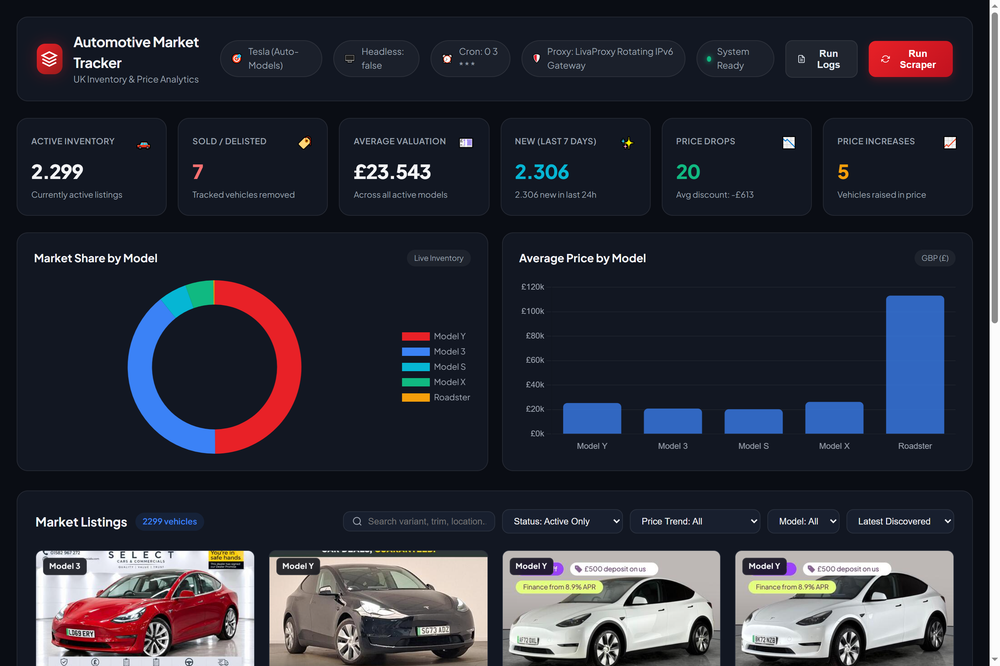
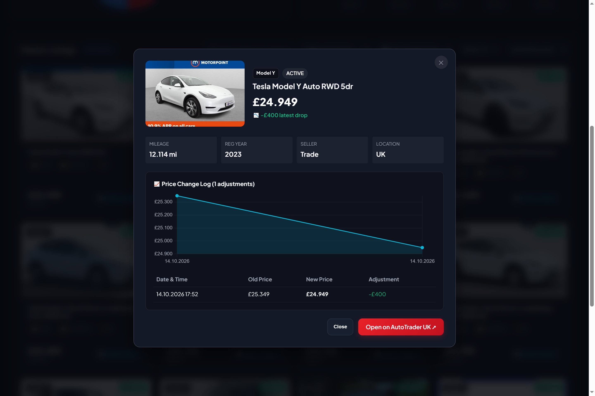
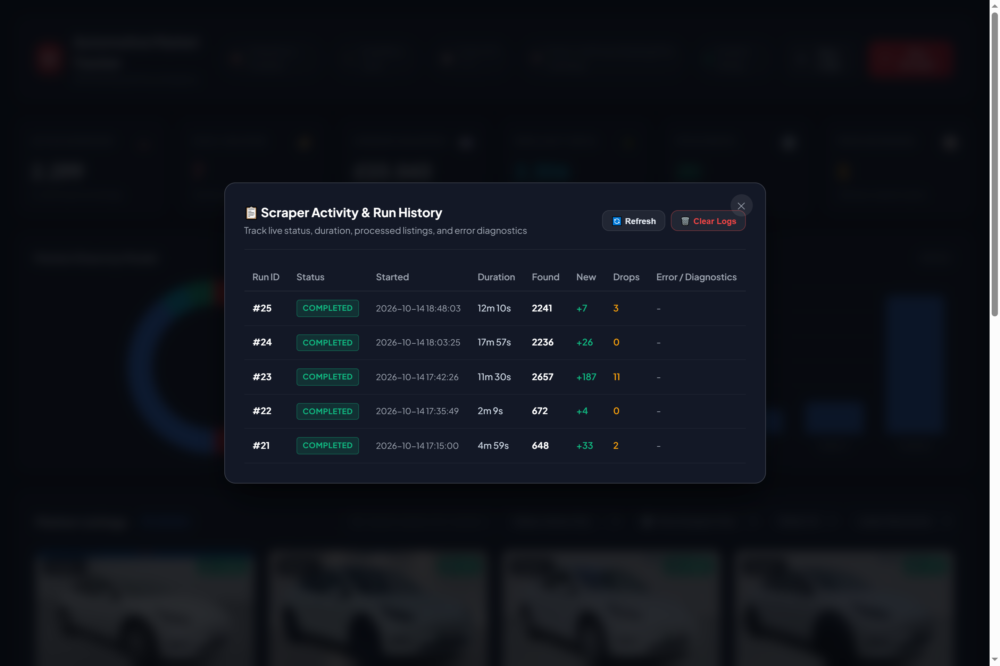

# 🚗 Automotive Market Tracker

A web scraping pipeline and analytics dashboard for tracking used-car inventory and price changes on a UK automotive marketplace. Built with **Node.js**, **Patchright (Playwright)**, **Express.js** and **SQLite**.


> **⚠️ Disclaimer:** This is a personal portfolio project built to demonstrate web scraping and data engineering techniques. It is not intended for commercial use, no collected data is published or redistributed, and it is not affiliated with any marketplace. If you use any part of it, respect the target website's terms of service and rate limits.

### 📊 Live Analytics Dashboard


### 📈 Vehicle Price History & Specifications


### 📋 Scraper Run History & Diagnostics


---

## ✨ What It Does

- Crawls marketplace search results for a configured make (e.g. Tesla, BMW) and stores every listing in SQLite.
- Detects **price changes** on each run and keeps a full price history per vehicle.
- Detects **sold / delisted** vehicles and verifies them before marking them as sold.
- Shows everything on a local dashboard with charts, filters and scraper controls.
- Runs on a schedule (cron) or on demand from the UI / CLI.

---

## 🛠️ Technical Highlights

**Scraping**
- **Browser automation on a JavaScript-heavy SPA** using Patchright with a pool of parallel workers.
- **Anti-bot challenge handling:** human-like mouse movement (`ghost-cursor`), interaction simulation and automatic recovery when a challenge or error page appears.
- **Error recovery:** detects the site's "Refresh page" error screen, retries pages and restarts browser contexts when needed.
- **Taxonomy-based partitioning:** discovers available models for a make automatically and crawls each model separately to work around the site's page-depth limit.
- **Delisting verification:** search results shift while crawling ("pagination drift"), so a listing missing from results isn't immediately marked sold — its detail page is checked first to avoid false positives.

**Proxy layer**
- Supports rotating IPv6 gateways, 4G mobile proxies (IP reset via API URL with cooldown, limited to a single worker) and residential sticky sessions.
- Proxy and `.env` settings are re-read at runtime, so most changes apply without restarting the server.

**Data & Dashboard**
- SQLite (`better-sqlite3`) in WAL mode with indexes on frequently queried columns.
- Price history table records `old_price`, `new_price`, difference and timestamp for every change.
- Price trend filter (drops 📉 / increases 📈) is based on the most recent change.
- Dashboard built with vanilla HTML/CSS/JS and Chart.js: stats, model breakdown, filters, vehicle detail modal with price history chart, start/stop controls and run logs.

---

## 📁 Project Structure

```
automotive-market-tracker/
├── config/
│   ├── targets.example.json     # Make, models and postcode settings (copy to targets.json)
│   └── proxies.example.json     # Proxy pool template (copy to proxies.json, gitignored)
├── src/
│   ├── db/
│   │   ├── database.js          # SQLite connection (WAL), queries & operations
│   │   └── schema.sql           # Tables: listings, price_history, scrape_runs
│   ├── scraper/
│   │   ├── index.js             # CLI entry point
│   │   ├── engine.js            # Crawl engine, worker pool & delisting verification
│   │   ├── parser.js            # Listing card parsing & spec extraction
│   │   ├── humanMouse.js        # Human-like mouse movement & challenge handling
│   │   ├── proxyManager.js      # Proxy rotation, mobile IP reset & hot-reload
│   │   └── targetManager.js     # Model discovery & crawl queue generation
│   ├── cron/
│   │   └── scheduler.js         # Scheduled background runs
│   └── web/
│       ├── server.js            # Express REST API & static server
│       └── public/              # Dashboard (HTML, CSS, JS, Chart.js)
├── data/                        # SQLite database (gitignored)
├── docs/                        # Screenshots & documentation assets
├── .env.example
└── package.json
```

---

## 🚀 Quick Start

**Requirements:** Node.js 18+ and Google Chrome.

```bash
npm install

cp .env.example .env
cp config/targets.example.json config/targets.json
cp config/proxies.example.json config/proxies.json

npm start
```

Open **http://localhost:3000**.

Run the scraper directly from the CLI:

```bash
npm run scrape

# or with options
node src/scraper/index.js --make Tesla --pages 50 --workers 4 --headless new
```

> [!NOTE]
> The API has no authentication and is meant to run locally only.

---

## ⚙️ Configuration

### `.env`

| Variable | Default | Description |
| :--- | :--- | :--- |
| `PORT` | `3000` | Dashboard port |
| `HEADLESS` | `new` | `new` (modern headless), `true` (classic headless) or `false` (visible browser) |
| `DB_PATH` | `./data/tracker.sqlite` | SQLite file path |
| `CRON_ENABLED` | `true` | Enable scheduled runs |
| `CRON_SCHEDULE` | `0 3 * * *` | Cron expression (default: daily at 03:00) |
| `CRON_PAGES` | `120` | Max pages per model for scheduled runs |

### `config/targets.json`

```json
{
  "make": "Tesla",
  "models": "auto",
  "postcode": "SW1A 1AA",
  "maxPagesPerModel": 100
}
```

- `models`: `"auto"` to discover models automatically, or a list such as `["Model 3", "Model Y"]`.
- `postcode`: UK postcode used for location-based search.

### `config/proxies.json`

See [`config/proxies.example.json`](config/proxies.example.json). Main options:

- `enabled`: turn proxies on/off (off = direct connection).
- `concurrency`: number of parallel browser workers.
- `rotationIntervalPages`: rotate IP every N pages.
- `minMobileCooldownSeconds`: minimum wait between mobile IP resets.
- `type`: `ipv6_rotating`, `mobile_rotating` or `residential_sticky`.

---

## 🔌 REST API

| Endpoint | Method | Description |
| :--- | :--- | :--- |
| `/api/stats` | `GET` | Market overview, proxy, target and scheduler status |
| `/api/listings` | `GET` | Paginated listings with search, model, status and price trend filters |
| `/api/listings/:id` | `GET` | Vehicle details and price history |
| `/api/price-changes` | `GET` | Recent price changes |
| `/api/runs` | `GET` | Scraper run history |
| `/api/runs` | `DELETE` | Clear run history |
| `/api/scrape` | `POST` | Start a background run (`{ pages, make, headless }`) |
| `/api/scrape/stop` | `POST` | Stop the active run |

---

## 📄 License

MIT — for educational and portfolio purposes.
